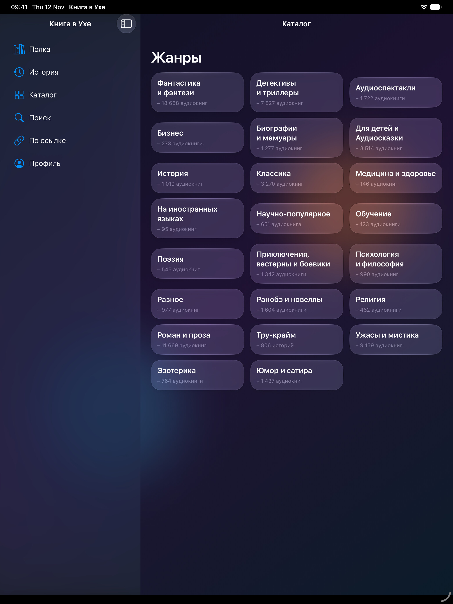
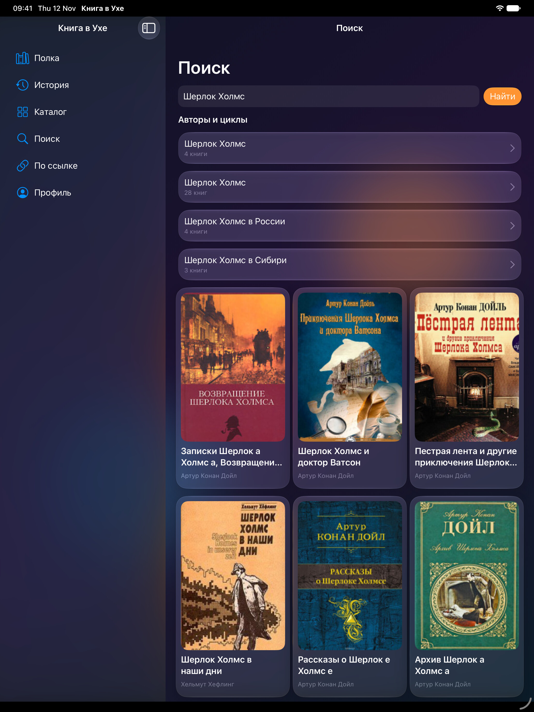
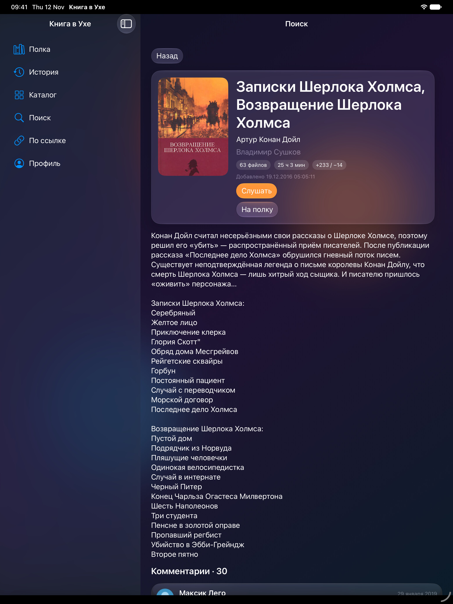

# Книга в Ухе

Слушайте аудиокниги с knigavuhe.org на Mac, iPhone и iPad. На Mac книги также можно скачивать.

В каталоге книги разложены по жанрам. Можно искать по названию, автору и циклам или вставить ссылку на книгу. Слушать можно сразу, не дожидаясь полной загрузки: программа запоминает место и скорость. На Mac, пока одна книга качается, следующую можно поставить в очередь. После входа на сайте появляются полка и история прослушиваний.

Страница программы: [cyprus-team.com/knigavuhe](https://cyprus-team.com/knigavuhe)

Сайт студии: [cyprus-team.com](https://cyprus-team.com/)

Версия для macOS: [1.1](https://github.com/cyprus-team/knigavuhe/releases/tag/v1.1) · [Скачать Knigavuhe.dmg](https://github.com/cyprus-team/knigavuhe/releases/download/v1.1/Knigavuhe.dmg)

DMG подписан сертификатом Developer ID и прошёл нотаризацию Apple. Нужна macOS 26, сборка одна для Apple silicon и Intel.

## iPhone и iPad — версия 1.1

Нужна iOS или iPadOS 26 и новее. На iPhone и iPad доступно потоковое и фоновое воспроизведение. Мобильная версия готовится к публикации в App Store.

### iPhone

### iPad

[История изменений](CHANGELOG.md)

## Снимки macOS

