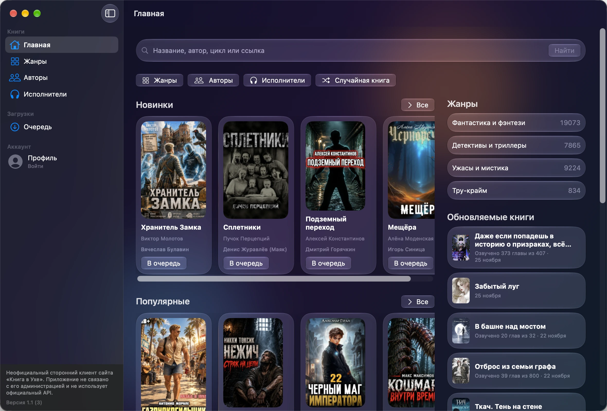
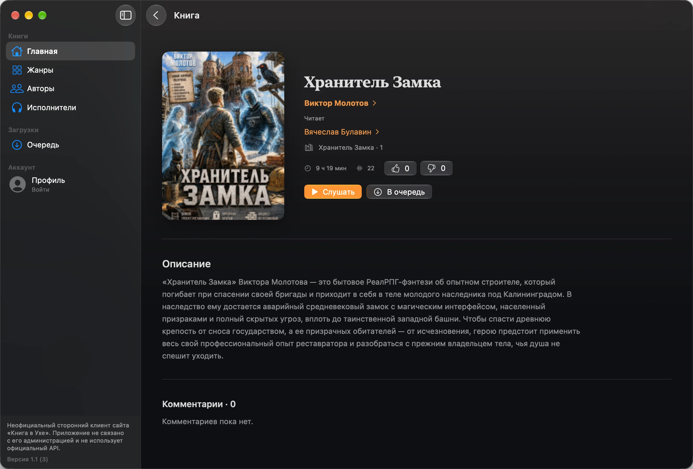
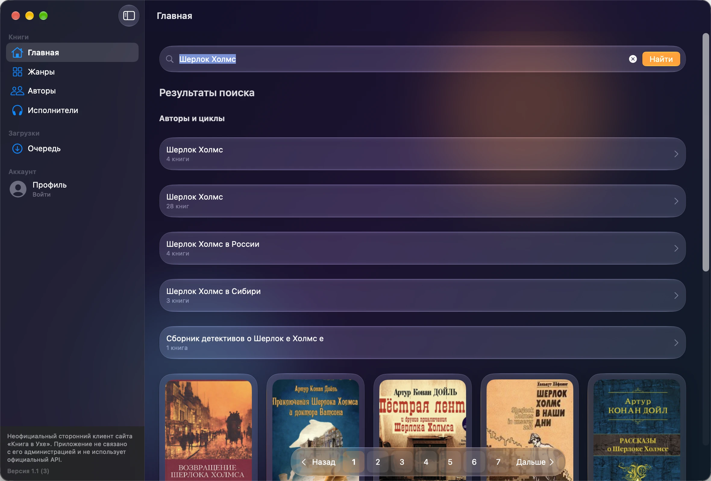
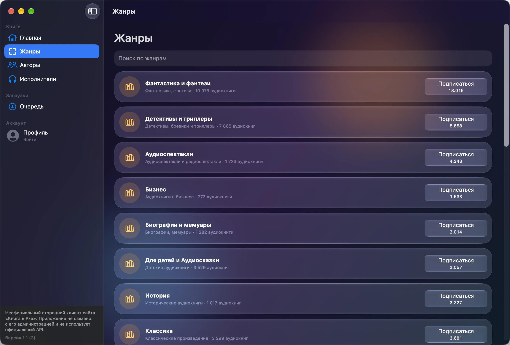

# Авоська

«Авоська» — бесплатное приложение для прослушивания русскоязычных аудиокниг с knigavuhe.org на Mac, iPhone и iPad. На Mac книги также можно скачивать для прослушивания без интернета.

На главной собраны новинки, популярные и обновляемые книги. Можно искать по названию, автору или циклу, просматривать жанры и открывать книги по ссылке. Плеер запоминает позицию и скорость воспроизведения. После входа доступны книжная полка и история прослушиваний.

**В ближайшее время планируем отправить версию для iPhone и iPad на проверку Apple. Релиз в App Store ожидается после одобрения.**

[Страница приложения](https://cyprus-team.com/avoska) · [Сайт студии](https://cyprus-team.com/) · [История изменений](CHANGELOG.md)

## macOS

[Скачать опубликованную версию 1.1](https://github.com/cyprus-team/avoska/releases/download/v1.1/Knigavuhe.dmg). Требуется macOS 26 или новее. Сборка подходит для Apple silicon и Intel, подписана сертификатом Developer ID и прошла нотаризацию Apple.

## iPhone и iPad

Требуется iOS или iPadOS 26 и новее. Поддерживается потоковое и фоновое воспроизведение.

| Устройство | Главная | Поиск | Страница книги |
| --- | --- | --- | --- |
| iPhone |  |  |  |
| iPad |  |  |  |
